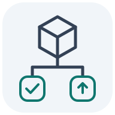

<p align="center">
  
</p>

# SameByte

[](https://github.com/0then0/samebyte/actions/workflows/ci.yml)
[](https://github.com/0then0/samebyte/releases/latest)
[](https://nodejs.org/)
[](LICENSE)

**Test the same bytes you deploy.**

SameByte is a local, open-source CLI that traces OCI artifact identity through GitHub Actions workflows. A green workflow does not necessarily test the image it deploys:

```text
npm build → npm test
                 ↓
            docker build → deploy
```

```console
$ samebyte tests/fixtures/rebuild.yml
SB001 HIGH [mismatch]
Production artifact was never tested. Source tests ran, but no recognized OCI test consumes the deployed digest.
```

Build the image once, publish its digest, and pass that digest to every consumer:

```text
build → OCI digest
          ├── docker run (tests)
          ├── Trivy
          ├── attestation
          └── deployment
```

```console
$ samebyte tests/fixtures/correct.yml
Deployment: ghcr.io/acme/api@<symbolic build digest> [proven]
  test: proven
  scan: proven
  attest: proven
Detected deployment lineage is proven. Pipeline coverage is incomplete.
```

The output above abbreviates the symbolic digest and omits the coverage notice for the opaque `actions/checkout` call. SameByte does not run a build or fetch its real digest. It proves that supported consumers reference the same output. Complete examples are in the repository’s [workflow fixtures](https://github.com/0then0/samebyte/tree/main/tests/fixtures).

## Install a release

SameByte requires Node.js 22 or later. Each stable `vX.Y.Z` tag creates a GitHub Release with a versioned npm package tarball and SHA-256 checksums. The package tarball installs through npm without a registry account:

```bash
npm install --global https://github.com/0then0/samebyte/releases/download/v0.1.2/samebyte-0.1.2.tgz
samebyte .
```

Replace `0.1.2` in both places with the release version you want. To verify a downloaded asset before installing it:

```bash
curl -fLO https://github.com/0then0/samebyte/releases/download/v0.1.2/samebyte-0.1.2.tgz
curl -fLO https://github.com/0then0/samebyte/releases/download/v0.1.2/SHA256SUMS
sha256sum --check SHA256SUMS
npm install --global ./samebyte-0.1.2.tgz
```

On macOS, use `shasum -a 256 --check SHA256SUMS` instead of `sha256sum --check`.

## Usage

```bash
samebyte .
samebyte .github/workflows
samebyte .github/workflows/release.yml
samebyte check . --format text
samebyte explain .
samebyte graph .
samebyte . --format json
samebyte . --format sarif > samebyte.sarif
samebyte . --format sarif --output reports/samebyte.sarif
samebyte . --config samebyte.config.json
```

A repository path scans `.github/workflows/*.yml` and `*.yaml`. A directory path scans its immediate YAML files. Files are analyzed independently: identity is not joined across workflow runs.

Text and `explain` show deployments, unknown identity reasons (including untracked OCI platform selection), and unsupported coverage boundaries. `explain` also prints finding evidence paths. `graph` shows artifacts, producers, consumers, and a separate list of coverage boundaries. `--format json` exposes operations, findings, diagnostics, deployment checks, and the structured `coverage` array. `--format sarif` emits SARIF 2.1.0 findings with workflow locations and evidence; coverage boundaries are invocation notifications at `note` level, not violation results.

Exit codes:

- `0`: analysis completed without high-confidence findings. This can include unknown lineage or no supported deployments.
- `1`: at least one high-confidence finding, including a mutable deployment reference.
- `2`: an input, configuration, YAML, dependency-graph, or analysis error. Errors take precedence over findings.

`--output <file>` writes the report in the selected format to a file instead of stdout; stdout stays empty and errors go to stderr. A relative path resolves against the working directory and missing parent directories are created. The file appears atomically and only when analysis completed (exit `0` or `1`). After an analysis error (`2`) or a failed write no report file is created, because a partial report would look like a complete one to consumers such as Code Scanning. A write failure exits `2` even when there are also findings. A file that already exists at that path is left untouched when no new report is written, so write each run's report to a fresh location, such as `${{ runner.temp }}` in the Action.

`Artifact lineage verified within the supported analysis scope` requires all detected deployments to have proven **test, scan, and attestation** identity, with no findings, errors, or recorded coverage boundaries. With boundaries present, proven deployments remain proven and the summary says `Detected deployment lineage is proven. Pipeline coverage is incomplete.` Missing checks remain `unknown`; their absence alone does not cause a violation. No supported deployments is reported explicitly and never counts as verified lineage. Exit code `0` describes analyzer completion, not a complete pipeline proof.

## GitHub Action

```yaml
- uses: actions/checkout@v7
- uses: 0then0/samebyte@v0.1.2
  with:
    path: .github/workflows
    format: sarif
    output: ${{ runner.temp }}/samebyte.sarif
```

A prebuilt `node24` action that does not install or change Node.js. With `output` it writes a report file that you can pass to `github/codeql-action/upload-sarif`. Inputs, outputs, the full upload workflow and failure behavior are in [docs/github-action.md](https://github.com/0then0/samebyte/blob/main/docs/github-action.md).

## Documentation

- [Analysis reference](https://github.com/0then0/samebyte/blob/main/docs/analysis.md): coverage boundaries, supported data flow, producers and consumers, findings (SB001–SB006), shell analysis and annotations.
- [GitHub Action](https://github.com/0then0/samebyte/blob/main/docs/github-action.md): inputs, outputs and Code Scanning upload.
- [Real-world workflow examples](https://github.com/0then0/samebyte/blob/main/docs/evidence/README.md): pinned upstream pipelines with saved reports and replay commands.
- [Changelog](https://github.com/0then0/samebyte/blob/main/CHANGELOG.md): released changes.

## Scope

SameByte checks lineage and identity only. It does not replace SLSA, in-toto, or Sigstore; scan vulnerabilities; sign artifacts; assess Dockerfiles or test quality; run CI; or guarantee supply-chain security. Reusable workflows, arbitrary binaries, non-GitHub CI, and generic build-system analysis are outside this version.

## Community and support

- [Contributing](https://github.com/0then0/samebyte/blob/main/CONTRIBUTING.md): local setup, tests, source layout, pull requests, and releases.
- [Issue forms](https://github.com/0then0/samebyte/issues/new/choose): bug reports and feature requests with reproducible examples.
- [Code of conduct](https://github.com/0then0/samebyte/blob/main/CODE_OF_CONDUCT.md): participation expectations and reporting concerns.
- [Security policy](https://github.com/0then0/samebyte/security/policy): supported versions, trust model, and private vulnerability reporting.

## License

[Apache-2.0](LICENSE).
